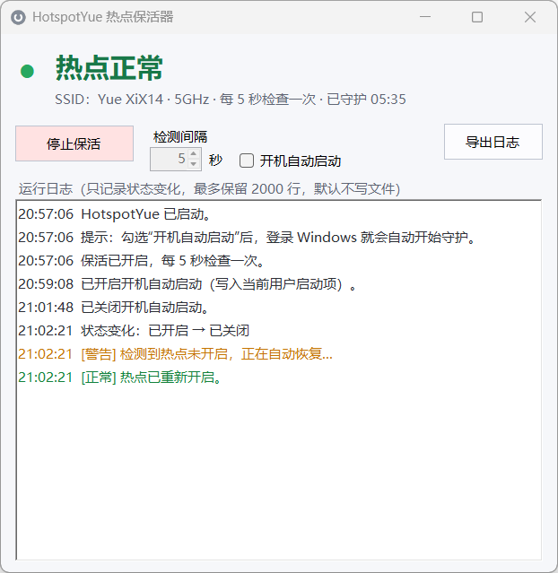

# HotspotYue · 热点保活器

Win11 的移动热点被荣耀工作台之类的程序周期性掐断，这个工具负责盯着它、发现断了就立刻拉回来。

单文件 exe，**32 KB，零依赖**（.NET Framework 4.8 是 Win11 自带的），双击即用，不需要装 .NET SDK、不需要 Visual Studio。



## 和分享里那套方案的区别

分享里的方案是「C# 外壳 + PowerShell 脚本」双进程：C# 只负责显示，真正的检测和开关都在 `keepalive.ps1` 里。这个版本把 PowerShell 整个去掉了：

| | 分享里的方案 | HotspotYue |
|---|---|---|
| 热点控制 | PowerShell 脚本调 WinRT | C# 直接调 `NetworkOperatorTetheringManager` |
| 依赖 | `powershell.exe` + 脚本路径必须是纯英文 | 无，单 exe |
| 异步处理 | 反射包装 `IAsyncOperation` | 自写 awaiter，`await` 直接用 |
| 权限 | `requireAdministrator`，每次弹 UAC | **实测标准用户即可**，不弹 UAC |
| 开机自启 | 未涉及 | HKCU Run，登录静默启动到托盘 |
| 日志 | 界面显示 | 界面显示 + 2000 行环形缓冲 + 可导出 |

## 目录结构

```
HotspotYue/
├── src/
│   ├── Program.cs          单实例、命令行参数
│   ├── MainForm.cs         界面、托盘、保活循环
│   ├── TetheringEngine.cs  WinRT 热点读写
│   ├── Logger.cs           内存环形日志
│   ├── Autostart.cs        HKCU Run 自启
│   ├── WinRtAwait.cs       IAsyncOperation 的 await 支持
│   └── app.manifest        DPI、Win10/11 兼容声明
├── tools/
│   ├── hsctl.cs            外部检查/启停热点的小工具（调试用，非必需品）
│   └── hsctl.exe
├── bin/
│   ├── HotspotYue.exe      最终产物
│   └── HotspotYue.ico
└── build.ps1               一键编译
```

## 使用

1. 双击 `bin\HotspotYue.exe`。
2. 点「开启保活」：会立刻打开热点，之后每 5 秒检查一次。
3. 关掉窗口只是收进托盘，保活继续；要真正退出，右键托盘图标 →「退出」。
4. 勾选「开机自动启动」：写当前用户的 Run 项，下次登录自动进托盘并开始保活。

托盘图标颜色：绿色 = 热点正常，红色 = 热点断开正在恢复，灰色 = 保活已停止。

## 行为细节

- **检测周期**：默认 5 秒，可调 2–60 秒。运行中改周期立即生效。
- **退避**：连续恢复失败 3 次后，间隔自动拉长到 30 秒，避免和抢热点的程序死循环对打。
- **恢复**：`StartTetheringAsync`，成功后托盘气泡提示一次；失败时只记日志，不弹窗骚扰。
- **日志**：只在状态变化时写，最多保留 2000 行，默认完全不落盘。需要时点「导出日志」。
- **单实例**：重复双击不会开出第二个进程，而是把已有窗口叫出来。

## 重新编译

```powershell
powershell -ExecutionPolicy Bypass -File .\build.ps1
```

脚本直接调用 Windows 自带的 `C:\Windows\Microsoft.NET\Framework64\v4.0.30319\csc.exe`，引用 `System32\WinMetadata` 下的 WinRT 元数据编译。没有 NuGet、没有 SDK、没有联网。

## 实测记录

在本机（Windows 11 家庭版 26300）上：

- 标准用户调用 `StartTetheringAsync` / `StopTetheringAsync` 均返回 `Success`，无需管理员权限；
- 外部停止热点模拟被掐断，应用在 6.7 秒内完成 `Off → InTransition → On`；
- 应用日志对应记录：`状态变化：已开启 → 已关闭` → `[警告] 检测到热点未开启，正在自动恢复…` → `[正常] 热点已重新开启。`

## 已知限制

- 依赖 Win11 的「移动热点」功能（`Windows.Networking.NetworkOperators`）。旧系统的「承载网络」`netsh wlan set hostednetwork` 不适用。
- 没有网络连接时热点无法开启，界面会显示「读取失败」并记录原因。
- 断线恢复靠轮询，所以最短恢复延迟等于检测周期。
- 想彻底清除：取消勾选自启 + 删除 exe 本体即可，程序不写任何注册表以外的位置。

[](https://github.com/deepseek-ai/deepseek-harness)